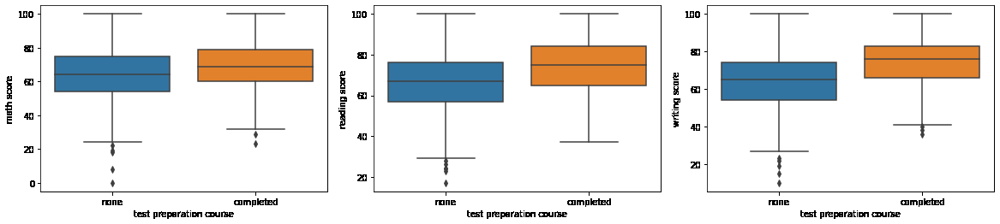
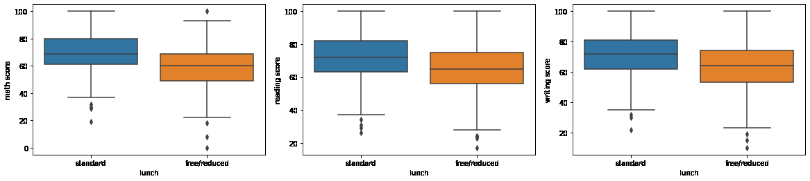
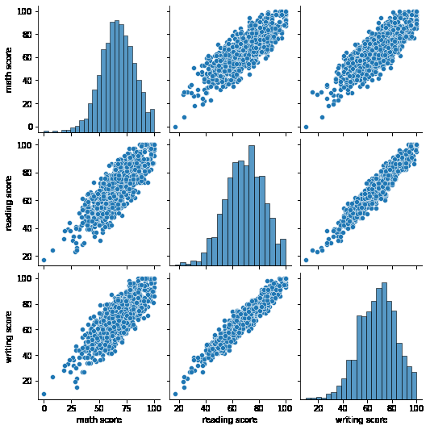
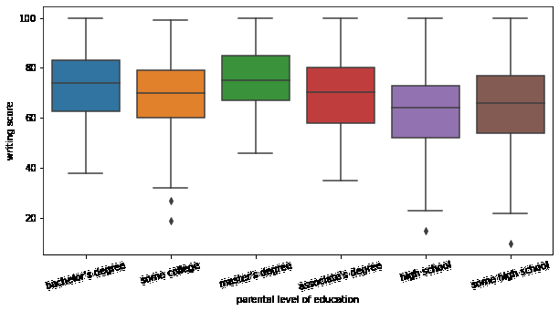

# Student Performance Prediction

A machine learning project that explores which factors relate to students' exam results and predicts a student's writing score from their background and their math and reading scores.

   

## Table of Contents

- [Overview](#overview)
- [Dataset](#dataset)
- [Key Findings](#key-findings)
- [Model](#model)
- [Results](#results)
- [Installation and Usage](#installation-and-usage)
- [Project Structure](#project-structure)
- [Limitations and Future Work](#limitations-and-future-work)
- [Acknowledgements](#acknowledgements)

## Overview

Schools want to spot students who may need extra support early. This project analyses 1,000 student records to see how gender, ethnic group, parental education, lunch type and test preparation relate to scores in math, reading and writing. It then builds a model that predicts a student's writing score.

The workflow covers exploratory data analysis, preprocessing with a scikit-learn `ColumnTransformer`, a modelling `Pipeline`, hyperparameter tuning with `GridSearchCV`, saving the model with `joblib`, and predicting the score of a new, unseen student.

## Dataset

[Students Performance in Exams](https://www.kaggle.com/datasets/spscientist/students-performance-in-exams) (Kaggle): 1,000 students, 8 columns, no missing values.

| Column | Description |
| --- | --- |
| gender | female / male |
| race/ethnicity | group A to E |
| parental level of education | from "some high school" to "master's degree" |
| lunch | standard or free/reduced |
| test preparation course | completed or none |
| math score, reading score, writing score | exam scores from 0 to 100 |

## Key Findings

**1. Test preparation helps.** Students who completed the preparation course scored higher in every subject, by about 10 points in writing (74.4 vs 64.5).

<p align="center">
  
</p>

**2. Lunch type is linked to results.** Students with a standard lunch scored higher than those with free or reduced lunch, by about 11 points in math (70.0 vs 58.9). Lunch type often reflects family income.

<p align="center">
  
</p>

**3. The three scores move together.** Reading and writing are very strongly correlated (0.95); math is strongly correlated with both (about 0.8).

<p align="center">
  
</p>

**4. Parental education matters.** Students whose parents have a higher level of education tend to score higher.

<p align="center">
  
</p>

## Model

| Step | Details |
| --- | --- |
| Target | Writing score |
| Features | Gender, ethnic group, parental education, lunch, test preparation, math score, reading score |
| Preprocessing | One-hot encoding of the 5 categorical columns (`ColumnTransformer`); numeric scores passed through |
| Model | LightGBM regressor (`LGBMRegressor`) inside a scikit-learn `Pipeline` |
| Tuning | `GridSearchCV` with 5-fold cross-validation over the number of trees (100 to 190) and boosting type (dart, gbdt, goss) |
| Metric | Root mean squared error (RMSE) |

## Results

- **Best model:** LightGBM with `goss` boosting and 150 trees
- **Cross-validated RMSE: 3.88 points** on a 0 to 100 scale, compared with a standard deviation of 15.2 points in writing scores

**Example prediction for a new student:** female, group A, parents with high school education, standard lunch, completed test preparation, math 50, reading 87. **Predicted writing score: 80.3.**

## Installation and Usage

```bash
git clone https://github.com/Navya1223/student-performance-prediction.git
cd student-performance-prediction
pip install -r requirements.txt
jupyter notebook "Student performance ML project.ipynb"
```

Run the notebook from top to bottom. It trains the model, saves it as `model.joblib` and makes a prediction for a new student.

## Project Structure

```
student-performance-prediction/
├── Student performance ML project.ipynb   # Analysis, model training and prediction
├── StudentsPerformance.csv                # Dataset
├── requirements.txt                       # Python dependencies
└── images/                                # Charts used in this README
```

## Limitations and Future Work

- Reading score is a very strong predictor of writing score (correlation 0.95), so most of the model's accuracy comes from it. A useful next step is predicting scores from background factors only, which is harder but more useful for early support.
- 1,000 students is a small dataset; results may not generalise to other schools.
- Compare LightGBM with simpler baselines such as linear regression, and use a separate hold-out test set.
- Show which features matter most, for example with feature importance or SHAP values.

## Acknowledgements

- Dataset: [Students Performance in Exams](https://www.kaggle.com/datasets/spscientist/students-performance-in-exams) on Kaggle, originally generated by [Royce Kimmons](http://roycekimmons.com/tools/generated_data/exams).
- Project idea inspired by [Student's Performance Analytics](https://github.com/roshank1605A04/Student-s-Performance-Analytics) by Roshan Sharma.

## Technologies

Python, pandas, NumPy, Matplotlib, Seaborn, scikit-learn, LightGBM, joblib, Jupyter
